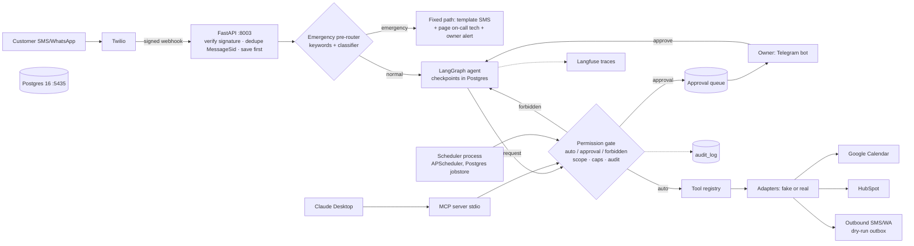

# P03 AI Operations Agent: PLAN

## Context
P03 is the third portfolio project: an AI "front-desk employee" for a home-service company (HVAC/plumbing). It
qualifies leads over SMS/WhatsApp, quotes from a price table, books jobs in Google Calendar, updates HubSpot, runs
Day 0/1/3/7 follow-ups, escalates emergencies by fixed rules, and gives the owner a Telegram assistant with
approval buttons. Tools are exposed through our own MCP server, usable by the agent and by Claude Desktop.
It proves the "action-taking agent" job type on Upwork (agents, MCP, multi-agent, human-in-the-loop).

**Decisions taken (2026-10-09):**
- **LangGraph, tiny graph** (pre-router → agent → permission gate → tools, plus an approval interrupt). Used for
  Postgres checkpoints and interrupt/resume, not for a big flowchart. Conversation logic stays in the agent.
- **Multi-agent in v1 as a small comparison:** supervisor + 2 specialists reusing the same tools and gate, behind
  a flag; decided by the scenario eval (ADR 006).
- **No Redis in v1:** Postgres holds scheduler jobs, webhook dedupe, approvals. Port 6381 stays reserved.
- **Dry-run by default; fakes for every external system;** real adapters only in live runs I approve.
- Owner channel: Telegram via **long polling** (no public URL needed). Teams is v2.
- Models via LiteLLM, cheap tier (Haiku class) by default; verify current model IDs and prices in Phase 0.

## Schedule risk (honest)
- The master plan had P03 on Sep 28–29; it's Oct 9. P02 is still in Phase 7.
- **Your budget: "just today".** My honest view is that the **full v1 does not fit in one day.** Here's why:
  - P01's live integrations ran at 2.8–4.9× their estimates.
  - P02's phases took hours each even with Claude writing the code.
  - P03 has 4 real integrations (Google OAuth/service account, HubSpot, Twilio, Telegram), a 20×3 scenario eval,
    5 experiments, and a demo video.
  - Realistic: **3 working days** (my guess ~20–28 h of your time; ESTIMATES.md will make it concrete).
- **What can be done today**, riskiest first: Phase 0 → Phase 1 → Phase 2. That gives a working agent with tools,
  permission gate, MCP server, emergency router and approval interrupt, all on fakes, all tested.
- **Cut order if we fall behind.** Moved to the end of P03, not deleted:
  1. HubSpot real adapter (fake + contract tests only)
  2. Inbound Twilio live run (needs a tunnel and your approval; outbound-only demo instead)
  3. Experiments beyond the required 3
  4. Multi-agent comparison
- **Never cut:** permission gate, emergency pre-router, dry-run, audit log, scenario eval, caps.
- Every phase ends in a working, committed state, so stopping at any phase boundary leaves a usable repo.

## Architecture (goes in docs/architecture.mmd)

Processes in `docker compose`: `api`, `scheduler`, `postgres`. The MCP server is started by Claude Desktop over
stdio (no port). The Telegram bot runs inside `scheduler` (long polling). Expected RAM: about 400 MB total.

### The graph (LangGraph)
```
inbound → pre_router ─emergency→ escalate → END
              │normal
              ▼
        compact_if_long → agent (LLM) ─tool calls→ gate ─auto→ run_tools → agent
                             │final text            ├approval→ interrupt() … owner approves → run_tools → agent
                             ▼                      └forbidden→ error message back to agent
                      output_guard → send_reply → END   (caps hit at any point → handoff → END)
```

## Conversation state (LangGraph `State`, one thread per customer: `thread_id = hmac(phone)`)
`customer_id` · `channel` · `messages` (add_messages reducer) · `summary` (compaction) ·
`intake {service_code, problem, address, zip, urgency, name}` · `offered_slots` · `booking_id` ·
`pending_approval_id` · `status` · `turn_tool_calls` · `conv_tool_calls` · `tokens` · `cost_usd` · `last_message_sid`.
`status` is set **by code from tool results**, never by the LLM:
`NEW → QUALIFYING → QUOTED → OFFERED → BOOKED → (RESCHEDULED | CANCELLED) → COMPLETED`.
Side states: `AWAITING_APPROVAL`, `HANDOFF`, `EMERGENCY` (agent paused until a human clears it), `OPTED_OUT`.

## Schema (Postgres, migrations in `migrations/`)
- **Business data:**
  - `customers` (phone E.164, phone_hash, name, email, address, zip, opted_out_at, crm_contact_id)
  - `services` (code, name, price_usd, duration_min, includes): **the price table**
  - `service_area_zips`, `technicians` (on_call flag), `faq`
  - `bookings` (customer_id, service_code, start, end, status, calendar_event_id, crm_deal_id): the source of truth
  - `calendar_events`: the fake calendar
- **Messaging:**
  - `inbound_messages` (message_sid UNIQUE: dedupe; body; received_at; processed_at)
  - `outbound_messages`: the outbox, with dry_run flag and status
- **Control:**
  - `approvals` (kind, payload, requested_by, status, decided_by, decided_at)
  - `idempotency_keys` (key, tool, result_json)
  - `audit_log` (append-only: ts, caller_role, customer_id, tool, args_redacted, decision, result, reason, trace_id)
  - `emergencies`, `followups`, `crm_outbox` (CRM sync retried later; a booking never fails because the CRM is down)
- **Library-owned:** LangGraph checkpoint tables and APScheduler job table.
- **Roles:** `p03_migrator` owns the tables; `p03_app` has DML only, no DDL, and only SELECT/INSERT on `audit_log`
  (no UPDATE or DELETE).

## Tool list (typed with Pydantic; every call goes through `gate.authorize(caller, tool, args)`)
`caller` = `{role: customer|owner|system, customer_id}`; for customers, `customer_id` comes **from the verified
phone, never from model arguments**.

| Tool | Signature (short) | Customer | Owner | Notes |
|---|---|---|---|---|
| get_my_profile | () → Profile | auto | n/a | own record only |
| update_my_contact | (name?, email?, address?, zip?) → Profile | auto | n/a | queues a CRM sync |
| check_service_area | (zip) → {in_area, nearest_note} | auto | auto | |
| get_price | (service_code) → {price_usd, includes, duration_min} | auto | auto | only source of prices |
| search_faq | (question) → [≤3 entries] | auto | auto | keyword match over ~30 rows, no embeddings (RAM) |
| find_slots | (service_code, date_from, date_to, part_of_day?) → [≤3 offerable slots] | auto | auto | merged "availability + offer" is experiment E3 |
| book_appointment | (slot_id, service_code, idempotency_key) → Booking | auto | auto | re-checks free/busy; max 2 active bookings per customer |
| reschedule_appointment | (booking_id, new_slot_id, idempotency_key) | auto if >24 h ahead, else approval | auto | own bookings only |
| cancel_appointment | (booking_id, reason) | auto if >24 h ahead, else approval (fee) | auto | |
| request_discount | (pct, reason) | approval if ≤15 %, forbidden >15 % | approval | owner taps Approve |
| request_refund | (booking_id, amount_usd) | approval | approval | |
| handoff_to_human | (reason) | auto | n/a | status → HANDOFF, owner alert |
| list_leads | (status?, since?) | forbidden | auto | owner reads |
| list_jobs | (date) | forbidden | auto | |
| draft_bulk_followup | (filter) → draft_id + preview | forbidden | auto | |
| send_bulk_followup | (draft_id) | forbidden | approval | |
| (not tools) | send_sms(to=…), delete_customer, export_customers, change_price, raw SQL | forbidden | forbidden | not implemented; unknown-tool calls are denied and audited |

**Done by code, not the LLM** (least agency, fewer tool calls):
- Sending the reply, always to the verified sender.
- CRM upsert of the contact and deal after a booking event, through `crm_outbox`.
- Paging the on-call tech for emergencies.
- Scheduling and cancelling follow-ups.

Tool errors are **recoverable**: `{ok: false, error: code, message: "what happened + what to do next"}`.

## Guardrails (enforced in code)
1. **Permission gate:** a single function used by the agent, MCP and the scheduler. It checks level, scope and caps,
   and writes the audit row. A parametrized test covers every (role × tool × case).
2. **Emergency pre-router:**
   - `config/emergency.yaml` holds keywords and regexes: gas smell or leak, carbon monoxide or CO alarm, flooding,
     water pouring, burst pipe, sparks, burning smell, and no heat plus a stated temperature below 50 °F.
   - Keywords decide alone. Ties go to escalation.
   - A Haiku classifier (2 s timeout) runs alongside, only to catch paraphrases the keywords miss. If it fails,
     the normal path continues and the keyword result stands.
   - The emergency path makes **no LLM call**.
3. **Output guard:**
   - Every `$` amount in a reply must match the price table.
   - A reply may only say "booked/confirmed" when this turn's state has a `booking_id`.
   - On failure: one repair, then a safe fallback text.
4. **Caps:**
   - 8 tool calls per inbound message, 40 per conversation per day, $0.25 per conversation.
   - Hitting any cap means handoff plus an owner alert.
5. **Injection:**
   - Customer text is data. Saved fields (name, notes) are escaped when they come back into context.
   - The gate is the real defence: even a fully hijacked model can only do what its role allows.
6. **AI disclosure line** in the first reply ("I'm CoolBreeze's virtual assistant").
7. **Messaging rules:**
   - Follow-ups only between 8 am and 8 pm customer time.
   - "STOP" opts the customer out permanently. Two cases are separate:
     - A2P 10DLC registration is documented as a go-live step.
     - The demo uses the WhatsApp sandbox or a trial account texting your verified number.

## Follow-up scheduler
- **Config:** `config/followups.yaml` with Day 0 (+1 h), 1, 3 and 7 after an unbooked enquiry, plus a reminder
  the day before a booking.
- **Scheduling:**
  - Separate `scheduler` process; APScheduler with a Postgres jobstore, so jobs survive restarts.
  - Idempotency key = `(customer_id, rule, day)`.
- **On each fire it re-reads state** and skips if the customer has booked, opted out, is in handoff or emergency,
  or it's quiet hours. Otherwise it sends through the gate (role `system`) and the outbox.
- **Tests** use a fake clock.

## Owner assistant (Telegram, long polling)
- **Read queries:**
  - "Which leads from yesterday haven't booked?"
  - "Summarize today's jobs"
- **The agent role is `owner`**, and it has read tools only.
- **Approvals** show as messages with inline Approve / Reject buttons. Only the owner's Telegram user ID
  (allow-list) can press them.
- **Bulk follow-up:** a draft and preview first, then send after approval.

## MCP server (ADR 004)
- **Built on** the official Python MCP SDK (FastMCP), wrapping the **same tool registry and gate**.
- **Transport:** stdio only in v1, for Claude Desktop with role `owner`.
  - Claude Desktop runs on Windows, so it starts the server through `wsl.exe`. Getting that config right is a
    timeboxed spike.
- **The agent calls the registry in-process by default.**
  - `TOOLS_VIA_MCP=true` makes the agent call the same tools through an MCP client instead.
  - A subset of scenarios is run both ways to prove the results are the same and to measure the extra latency
    (experiment E6).
- **No HTTP transport or public endpoint** without your approval.

## Multi-agent (ADR 006)
- **Setup:** a supervisor routes each turn to one of two specialists:
  - `intake_scheduling`: qualify, quote, book, reschedule
  - `billing_support`: discounts, refunds, cancellations with a fee, FAQ
- **Least agency:** each specialist sees only its own tools; the refund tool exists only in billing.
- **No new tools.** Same gate and same state; `AGENT_MODE=single|supervisor`.
- **Decided by** the 20-scenario comparison on pass rate, tokens, p95 latency and cost.

## Reliability and observability
- **Retries:**
  - Timeouts on every adapter.
  - tenacity retries with exponential backoff and jitter (only for safe or idempotent calls).
- **Circuit breaker per adapter:** 3 failures in 60 s opens it for 120 s. Fallbacks:
  - LLM: a fallback model through LiteLLM.
  - Calendar down: "we'll confirm by text shortly", plus an owner approval task.
  - CRM down: the outbox retries later.
- **Webhook flow:** verify the Twilio signature, insert into `inbound_messages` (duplicate SID means ignore),
  return 200 at once, then process in a background task and reply via the Twilio REST API. This is P01's
  "save first" pattern.
- **Tracing and logs:**
  - Langfuse: one trace per inbound message, with spans for each LLM and tool call, model, tokens, cost and latency.
  - JSON logs with phone numbers hashed.
- **`docs/RUNBOOK.md`:** provider outage, cost spike, bad action rollback (audit log → reverse action), stuck approvals.

## Eval plan (evals/)
- **`evals/scenarios/*.yaml` (20 scenarios),** each with: persona, goal, setup (calendar state, outages), expected
  tool subsequence, forbidden tools, final DB state, max tool calls, reply checks, and `reviewed: false`.
  1. Normal booking ×3
  2. Reschedule ×2
  3. Late cancel needing approval
  4. Incomplete info ×2
  5. Angry customer
  6. Double-booking race
  7. Duplicate lead / duplicate SID
  8. Emergencies ×3 (gas, flood, cold with no heat)
  9. Calendar outage
  10. CRM outage
  11. "90% discount" injection
  12. Asking for another customer's data
  13. Out of area
  14. FAQ question
  15. STOP opt-out
  16. Long thread (compaction)
  17. Injection stored in the name field (memory poisoning)
- **Who plays the customer:**
  - Haiku plays the customer from the persona, up to 12 turns.
  - Emergency, injection, STOP and duplicate scenarios use **scripted** messages instead. That's cheaper and
    deterministic.
- **Deterministic suites (free):**
  - Emergency phrasing set: about 40 phrasings including negatives like "no gas smell, just warm air". We report
    recall (target 100%) and the false-positive rate.
  - Permission matrix.
- **Report** (`make eval`): pass^3 per scenario, overall pass rate, forbidden actions executed (must be 0),
  average tool calls per booking, tokens, cost per conversation, p50/p95 latency per turn.
- **CI:** 5 scenarios with scripted customers and a recorded or mocked LLM, at $0.
- **Experiments** (`docs/benchmarks.md`; guardrail: pass rate may not drop by more than 1 scenario):
  - E1 per-step model routing
  - E2 prompt caching for the system prompt and tool schemas (check the minimum cacheable size first)
  - E3 merged availability+offer, fewer tool calls (target −25%)
  - E4 compaction on vs off for the long-thread scenario
  - E5 single vs supervisor
  - E6 in-process vs via MCP

## Cost and latency budget (estimates; replaced by Langfuse measurements)
- **Per conversation** (about 6 customer turns × 2–3 LLM calls, about 4k input tokens each):
  - Haiku-class uncached: about $0.06–0.09.
  - Target after caching and fewer calls: **≤ $0.03**.
  - Hard cap: $0.25.
- **Latency:**
  - Webhook acknowledged in under 1 s.
  - Reply to the customer: p95 ≤ 8 s per inbound message.
  - Emergency template sent in under 2 s (no LLM).
- **Eval spend:**
  - One full 20×3 run with a simulated customer costs about $3–6, so it needs your approval (above $2).
  - Experiments run 20×1 (about $1–2 each). Only the baseline and the final run are 20×3.
  - **Expected total API spend for P03: about $15-25** for the full plan (20x3 baseline, E1-E6, multi-agent). The owner has ~$8 credit left shared with P11, so each large run is announced before it is started. The cost guard prints a projection before every run.

## Phases and acceptance criteria
| Phase | What | Accepted when |
|---|---|---|
| 0 Foundations | git init, uv, ruff/mypy/pytest, compose (Postgres 5435), settings, JSON logs, LiteLLM wrapper with cost capture + cost guard, Langfuse, migrations + seed (prices, zips, techs, FAQ), CI skeleton, new P03 API key | `make setup && make test` green; one real traced LLM call visible in Langfuse; DB seeded |
| 1 Tools + gate + MCP | Pydantic tools, fake adapters, gate + audit, idempotency, double-booking guard, MCP server, Claude Desktop config; **draft the 20 scenarios** (eval first) | permission matrix test passes; same-key double call makes 1 booking; concurrent booking race makes 1 booking; MCP `tools/list` and `tools/call` work from an MCP client; **live run: Claude Desktop lists today's jobs (dry-run)** |
| 2 Agent + emergency + webhook | graph, Postgres checkpointer, approval interrupt, caps, compaction, output guard, pre-router, Twilio signature + dedupe, outbox | scripted Maria conversation via signed fake webhooks, **with an API restart mid-conversation**, ends BOOKED; emergency set recall 100%; discount request pauses, owner approve resumes; 90%-off attempt denied and audited |
| 3 Follow-ups + owner bot | scheduler, followups.yaml, quiet hours, STOP; Telegram bot (long polling), approvals, owner queries | fake-clock tests: follow-ups stop on booking/STOP; **live run: real Telegram bot answers "who hasn't booked?" and an approval tap resumes a paused thread** |
| 4 Real integrations | Google Calendar (service account, test calendar), HubSpot (dev account, private app token), Twilio (outbound to your verified number / WhatsApp sandbox; inbound only with tunnel approval); circuit breakers | each real adapter passes the same contract tests as its fake; **one live run per integration** (event on the test calendar, contact + deal in HubSpot, one message received on your phone) |
| 5 Evals + optimize | runner, baseline 20×3, supervisor mode, E1–E6, ADR 006, OWASP table (ADR 007) | baseline table; ≥ 90% pass^3 target or documented misses; 0 forbidden executed; ≥ 3 optimizations logged with before → after |
| 6 Package | README, architecture.mmd, DEMO_SCRIPT, LEARNING_LOG, RUNBOOK, compose (api, scheduler, postgres), Makefile, CI (unit + 5 mocked scenarios), demo video, ESTIMATES summary | `docker compose up` + `make demo` work from a fresh clone; CI green |

## ADRs (docs/adr/)
Written now: 001–005. Written during Phases 5–6: 006–007.
1. **001 Agent framework:** LangGraph, tiny graph, versus a plain Python loop (builds on P02 ADR 010).
2. **002 Tool permission model:** auto / approval / forbidden, scope from the verified phone, caps, the gate also
   writes the audit log.
3. **003 Emergency handling outside the LLM:** keywords decide; the classifier only adds coverage; no LLM on the
   emergency path.
4. **004 MCP boundary:** one registry and gate; stdio only; agent in-process by default, via MCP behind a flag.
5. **005 Memory and state storage:** checkpoints are conversation state only; our tables are the truth;
   compaction; no Redis.
6. **006 Single vs multi-agent:** decided by the eval.
7. **007 OWASP Agentic Top 10 mapping + least agency:** one row per risk with its control and the test that proves it.

## KB check (AI_ENGINEERING_KB.md and IDEAS.md): what fits P03 and the cheapest way in
| Concept / parked idea | Fit | Cheapest inclusion |
|---|---|---|
| Context engineering & compaction (IDEAS, score 9) | yes | `compact_if_long` node with one cheap call; facts live in typed state; E4 with/without |
| OWASP Agentic Top 10 + least agency (IDEAS, 8) | yes | ADR 007 table; role-scoped tools; no free `send_sms`; specialists see only their tools |
| Unbounded consumption / loop caps (OWASP LLM10) | yes | counters in state + $ cap per conversation → handoff |
| Audit log, runbook, circuit breaker (KB gap) | yes | audit written by the gate; RUNBOOK.md; per-adapter breaker + LiteLLM fallback |
| Multi-agent protection (KB gap) | yes | supervisor flag + E5 |
| Red teaming (KB, medium) | partly | 3 injection scenarios incl. stored injection in the name field; full campaign stays in P02 Phase 7 |
| AI disclosure (EU AI Act Art. 50; US state bot-disclosure laws) | yes, 1 line | first-reply disclosure |
| Online evals, prompt A/B, feedback loop, A2A, computer use | no | belong to P04 / P02 / P10 |

## Shared-standard non-negotiables check
| # | Requirement | Where it's covered |
|---|---|---|
| 1 | ADRs | 001–005 now; 006–007 later |
| 2 | Eval first | scenarios drafted in Phase 1, before the agent exists; `make eval` |
| 3 | Reliability | timeouts, retries with jitter, idempotency keys, output repair-then-fallback, breakers, outbox |
| 4 | Observability | Langfuse per turn, JSON logs, audit log |
| 5 | Cost & performance | cost per conversation, p50/p95; E1–E6 (≥ 3 required) |
| 6 | Security | env secrets, signature checks, least-privilege DB roles, no user-controlled SQL, gate |
| 7 | Tests | unit (gate, tools, router), integration (Maria flow with restart), scenario eval |
| 8 | Packaging | compose + Makefile: setup / test / eval / bench / demo |
| 9 | Docs | README, architecture.mmd, DEMO_SCRIPT, LEARNING_LOG, RUNBOOK |
| 10 | CI | lint + tests + 5 mocked scenarios |
| 11 | Estimation | ESTIMATES.md next, multipliers from tracker section B |

## Repo layout
```
app/
  api/        webhooks.py (Twilio), health.py
  agent/      graph.py, nodes.py, state.py, prompts.py, supervisor.py
  tools/      registry.py, schemas.py, customer_tools.py, owner_tools.py
  gate.py     authorize + audit
  emergency.py
  adapters/   calendar_{fake,google}.py, crm_{fake,hubspot}.py, messaging_{fake,twilio}.py
  scheduler/  followups.py, telegram_bot.py
  mcp_server.py
  llm.py      LiteLLM wrapper, cost capture, breaker
  db/ settings.py logging.py
config/       emergency.yaml, followups.yaml, permissions.yaml
migrations/  seed/  evals/scenarios/  evals/run.py  tests/  docs/adr/  scripts/
```

## What happens right after approval
1. Save this plan as `PLAN.md` in the repo.
2. Write ADRs 001–005.
3. Run `git init` (no commit until you say so).
4. STEP 5: ESTIMATES.md, asking you for O/M/P one phase at a time, with my numbers sealed.

## Verification (once code exists)
- `make test`: gate matrix, tools, idempotency, emergency set, webhook signature and dedupe.
- `make demo`: scripted Maria flow through signed fake webhooks, with a restart in the middle; shows the dry-run outbox.
- `make eval`: scenario table (with the cost guard).
- Live runs per integration, each approved by you.
- `docker compose up` from a fresh clone.
- Run `free -h` before any heavy job, one heavy job at a time across P02 and P03.

## Status (end of day 1, 2026-10-09)
- Phase 0: all acceptance checks met (33 tests green; real traced LLM call verified in Langfuse; DB migrated and seeded). **Not committed yet; Phase 0 close-out hours not collected yet.**
- Next: ask owner for Phase 0 actual hours + quiz answers (0.5/0.6) + commit decision; then Phase 1 (tools, permission gate, MCP, draft 20 scenarios). Get owner's O/M/P for Phase 1 first.
- Budget: owner has ~$8 credit shared with P11; announce any run above $0.50 first (spent so far: about $0.0001).
- Langfuse note: legacy trace API is gone for orgs created after 2026-09-16; use /api/public/v2/observations.
